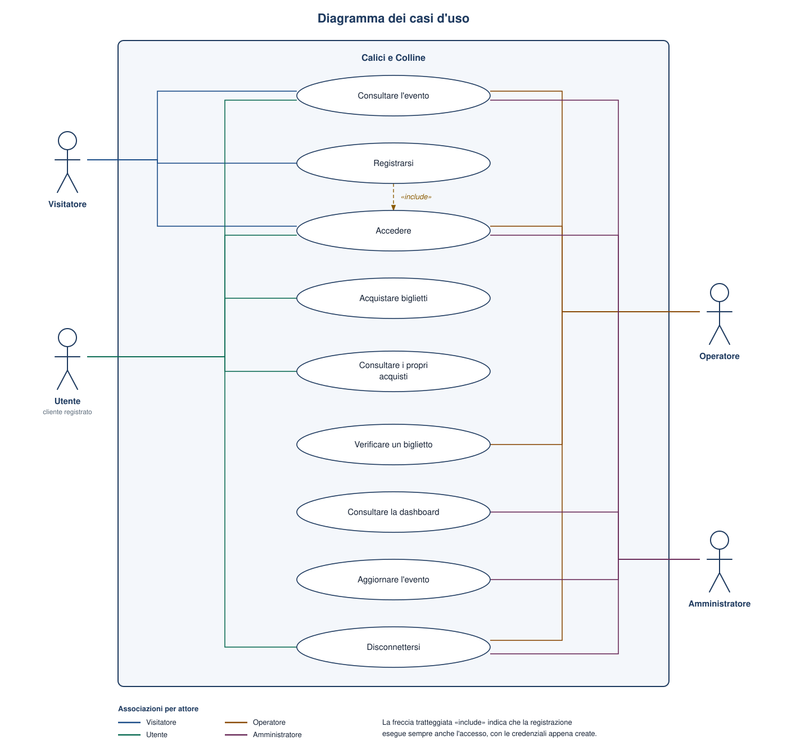
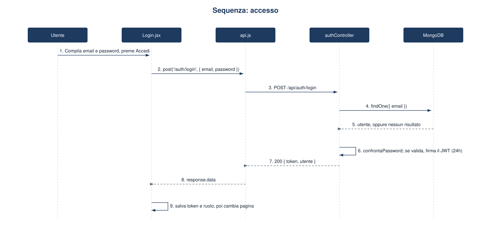
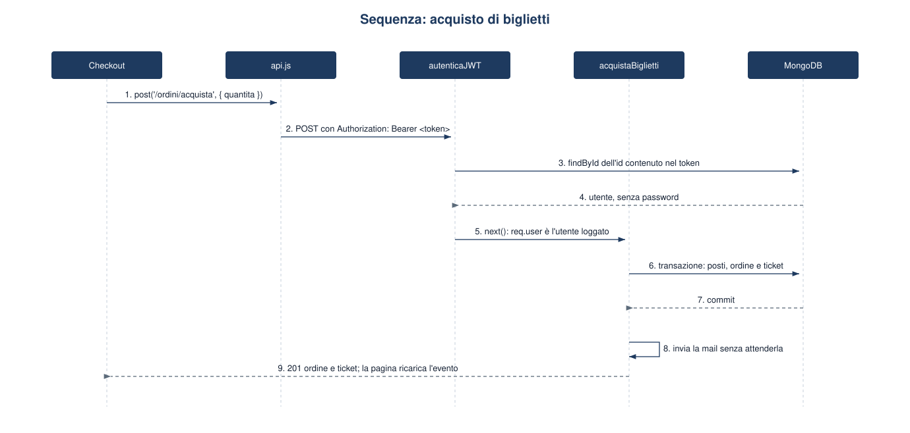
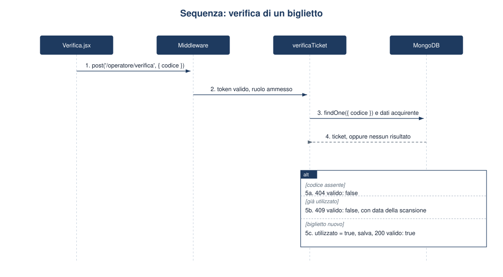

# Casi d'uso

Il diagramma mostra le funzioni del sistema e gli attori che le avviano. Il rettangolo è il confine del sistema. La linea colorata è un'associazione: il colore identifica l'attore, come nella legenda. La freccia tratteggiata `«include»` indica che il caso d'uso di partenza esegue sempre anche quello di arrivo.

`Consultare l'evento` e `Accedere` sono condivisi da più attori. `Disconnettersi` riguarda solo chi ha già una sessione. La verifica del biglietto è associata all'operatore, che ha la pagina dedicata, e all'amministratore, che può invocare la stessa API.

## Diagrammi di sequenza

I tre diagrammi seguono il codice delle funzioni principali. La freccia continua è una chiamata, quella tratteggiata è una risposta.

### Accesso

`Login.jsx` non costruisce l'intestazione Authorization: a questo punto il token non esiste ancora. `authController` cerca l'utente per email e delega il confronto della password al metodo `confrontaPassword` del model, che usa `bcrypt.compare`. Il JWT contiene solo `id` e `ruolo`. Il context salva quelle due informazioni, non il nome: la barra di navigazione decide i link in base al ruolo.

Se le credenziali non sono valide il controller risponde 401 e la pagina mostra il messaggio, senza cambiare route.

### Acquisto

L'interceptor di Axios aggiunge il token letto da `localStorage`. Il middleware non si fida solo della firma: ricarica l'utente e scarta l'hash della password prima di passare al controller. Il totale non arriva dal browser. È `prezzo dell'evento × quantità`, calcolato sul server.

La mail parte dopo il commit e non è attesa. Un problema SMTP non annulla l'ordine: i QR code restano nella pagina degli acquisti, perché nascono dal codice salvato sul ticket.

### Verifica

Il frammento `alt` è il punto in cui il controller distingue i tre esiti. Solo il ramo «biglietto nuovo» scrive sul database. Il codice letto dal QR è la stringa salvata nel ticket: il sistema non interpreta un'immagine, confronta il testo.
