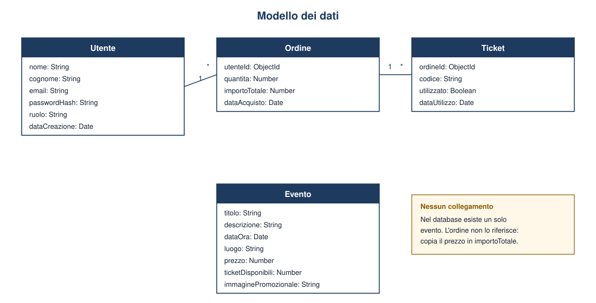

# Modello dei dati

I dati sono quattro collection MongoDB, descritte dagli schema Mongoose in `backend/models/`. Il nome della collection è la pluralizzazione inglese del model: `utentes`, `eventos`, `ordines`, `tickets`.

Le cardinalità si leggono così: un utente ha zero o più ordini; un ordine appartiene a un solo utente; un ordine ha uno o più ticket; un ticket appartiene a un solo ordine. L'evento non è collegato da una chiave esterna. Nel sistema ne esiste uno solo e l'ordine, al momento dell'acquisto, copia il prezzo nel proprio `importoTotale`.

## Utente

| Campo | Significato | Vincoli |
| --- | --- | --- |
| `nome`, `cognome` | Anagrafica. | Obbligatori. |
| `email` | Identificativo di accesso. | Obbligatoria, unica, salvata in minuscolo e senza spazi agli estremi. |
| `passwordHash` | Password cifrata. | Obbligatoria. In chiaro non resta nel database. |
| `ruolo` | Cosa l'utente può fare. | Uno tra `utente`, `operatore`, `amministratore`. Se non è indicato, vale `utente`. |
| `dataCreazione` | Istante di registrazione. | Impostato da Mongoose. Non esiste un campo di ultimo aggiornamento. |

Prima di ogni salvataggio, se `passwordHash` è stato modificato, uno hook del model genera il salt e sostituisce il valore con l'hash bcrypt. Registrazione e script di seed passano quindi la password in chiaro in quel campo: il nome del campo non significa che il valore sia già cifrato. Il confronto in fase di login usa `bcrypt.compare` e non decifra l'hash.

## Evento

| Campo | Significato | Vincoli |
| --- | --- | --- |
| `titolo`, `descrizione`, `luogo` | Testi della scheda pubblica. | Obbligatori. |
| `dataOra` | Data e ora dell'evento. | Obbligatoria. |
| `prezzo` | Prezzo di un biglietto, in euro. | Obbligatorio, maggiore o uguale a zero. |
| `ticketDisponibili` | Posti ancora in vendita. | Obbligatorio, maggiore o uguale a zero. Viene decrementato a ogni acquisto. |
| `immaginePromozionale` | URL di una locandina. | Facoltativo. Nessuna pagina lo visualizza. |

Non c'è una collection di eventi. Tutte le query usano `findOne()`.

## Ordine

| Campo | Significato | Vincoli |
| --- | --- | --- |
| `utenteId` | Riferimento all'utente che ha pagato. | Obbligatorio. ObjectId verso `Utente`. |
| `quantita` | Numero di biglietti dell'ordine. | Obbligatoria, almeno 1. |
| `importoTotale` | Prezzo unitario per la quantità, fissato all'acquisto. | Obbligatorio, maggiore o uguale a zero. |
| `dataAcquisto` | Istante di creazione dell'ordine. | Impostato da Mongoose. |

Un aggiornamento successivo del prezzo dell'evento non ricalcola gli ordini già salvati.

## Ticket

| Campo | Significato | Vincoli |
| --- | --- | --- |
| `ordineId` | Riferimento all'ordine. | Obbligatorio. ObjectId verso `Ordine`. |
| `codice` | Testo contenuto nel QR code. | Obbligatorio e unico. Se non viene passato, lo schema inserisce uno UUID v4. |
| `utilizzato` | Indica se il biglietto è già stato convalidato all'ingresso. | Booleano, falso alla creazione. |
| `dataUtilizzo` | Orario della convalida. | Vuoto finché `utilizzato` non diventa vero. |

Un ordine di tre biglietti produce tre documenti Ticket, non un documento con quantità tre. Il PNG del QR code non è un campo: si conserva solo `codice`. L'immagine viene ricostruita nella mail, con la libreria `qrcode`, e nella pagina acquisti, a partire dalla stessa stringa.

## Integrità durante l'acquisto

Decremento dei posti, inserimento dell'ordine e inserimento dei ticket avvengono nella stessa transazione. Se i posti non bastano, o se una scrittura fallisce, la transazione viene annullata e il client riceve l'errore. Non può restare un ordine senza ticket, né un posto scalato senza ordine.
