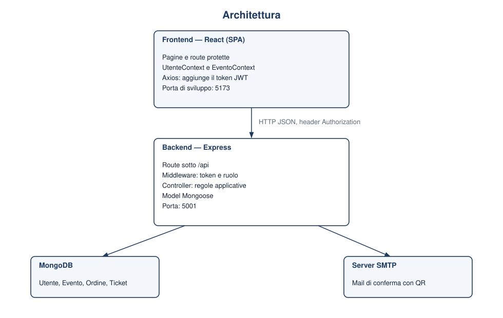

# Scenario e architettura

## Scenario

Calici e Colline è la biglietteria di un evento enogastronomico. L'applicazione gestisce un solo evento: data, luogo, prezzo e numero di posti sono unici per tutta la piattaforma.

Un visitatore consulta la scheda dell'evento. Per acquistare deve registrarsi o accedere. L'utente registrato sceglie la quantità di biglietti e conferma l'ordine: il sistema scala i posti, registra l'ordine e genera un biglietto per ogni posto, ciascuno con un codice univoco. Il codice è mostrato come QR code nell'area personale e, se la posta è configurata, anche nella mail di conferma.

All'ingresso, l'operatore legge il QR code con la fotocamera oppure digita il codice. Il sistema riconosce il biglietto, lo convalida la prima volta e rifiuta le scansioni successive. L'amministratore consulta i biglietti venduti, i posti rimasti, l'incasso e l'elenco degli acquirenti.

## Attori

| Attore | Descrizione |
| --- | --- |
| Visitatore | Persona non autenticata. Vede l'evento e può registrarsi o accedere. |
| Utente | Cliente registrato. Acquista biglietti e consulta i propri QR code. È il ruolo assegnato dalla registrazione. |
| Operatore | Addetto all'ingresso. Verifica i biglietti e non può acquistarli. |
| Amministratore | Gestore dell'evento. Consulta le vendite. Può aggiornare i dati dell'evento e creare operatori tramite API. |

Operatore e amministratore non si registrano dal sito: i loro account sono creati in anticipo.

## Architettura

L'applicazione è una single page application. Il browser scarica il client React e da quel momento cambia pagina senza ricaricare il documento: la navigazione è gestita da React Router. I dati arrivano dal backend con chiamate HTTP.

Il backend è un'API REST in Node.js ed Express. Non genera pagine HTML. Espone risorse sotto il prefisso `/api` e risponde in JSON. I dati persistenti stanno su MongoDB, tramite Mongoose. Dopo un acquisto andato a buon fine il backend può inviare una mail SMTP con i QR code allegati: se l'invio fallisce, l'ordine resta comunque valido.

Il frontend, in sviluppo, è servito da Vite sulla porta 5173. Il backend ascolta sulla porta indicata in `.env` (nel modello, la 5001). Sono origini diverse, quindi Express abilita CORS su tutte le risposte.

## Come viaggia una richiesta

1. La pagina React chiama il client Axios (`frontend/src/services/api.js`).
2. Se nel browser è salvato un token, Axios aggiunge l'intestazione `Authorization: Bearer <token>`.
3. Express legge il corpo JSON, individua la route e, se la route è protetta, esegue i middleware.
4. `autenticaJWT` verifica la firma del token, ricarica l'utente dal database e lo mette in `req.user`.
5. `autorizzaRuoli`, dove è presente, confronta `req.user.ruolo` con i ruoli ammessi da quella route.
6. Il controller applica la regola (acquisto, verifica, statistiche) e interroga i model.
7. La risposta JSON torna al componente, che aggiorna il proprio stato.

Il server non conserva una sessione. L'identità è il token JWT, firmato con `JWT_SECRET` e valido 24 ore. Il browser lo tiene in `localStorage` insieme al ruolo, così al ricaricamento della pagina l'utente risulta ancora autenticato. La password non è mai nel token: nel database è conservato solo l'hash prodotto da bcrypt al momento del salvataggio.

## Organizzazione del backend

| Cartella | Responsabilità |
| --- | --- |
| `routes/` | Associa l'URL al middleware e al controller. Non contiene la logica. |
| `middlewares/` | Autenticazione del token e controllo del ruolo. |
| `controllers/` | Regole applicative: login, acquisto, verifica, dashboard. |
| `models/` | Schema delle collection `Utente`, `Evento`, `Ordine`, `Ticket`. |
| `utils/` | Invio della mail e configurazione di Swagger. |
| `docs/` | Commenti OpenAPI letti da Swagger. Non sono route. |
| `scripts/seed.js` | Crea amministratore, operatore ed evento iniziale. |

L'acquisto è l'unica operazione racchiusa in una transazione MongoDB. Posti scalati, ordine e ticket vengono confermati insieme: se uno dei passaggi fallisce, nessuno di essi resta scritto.

## Organizzazione del frontend

Lo stato condiviso da più pagine sta in due Context:

- `UtenteContext` sa se c'è un utente autenticato e quale ruolo ha, ed espone le funzioni di accesso e uscita.
- `EventoContext` carica la scheda dell'evento all'avvio e la rende disponibile a home e checkout.

Le pagine che devono restare riservate non sono nascoste solo dai link della barra. Componenti di route (`SoloAutenticato`, `SoloOperatore`, `SoloAmministratore`) reindirizzano chi non ha il ruolo richiesto. Il controllo effettivo resta sul backend: una chiamata diretta a un'API non autorizzata riceve 401 o 403.
